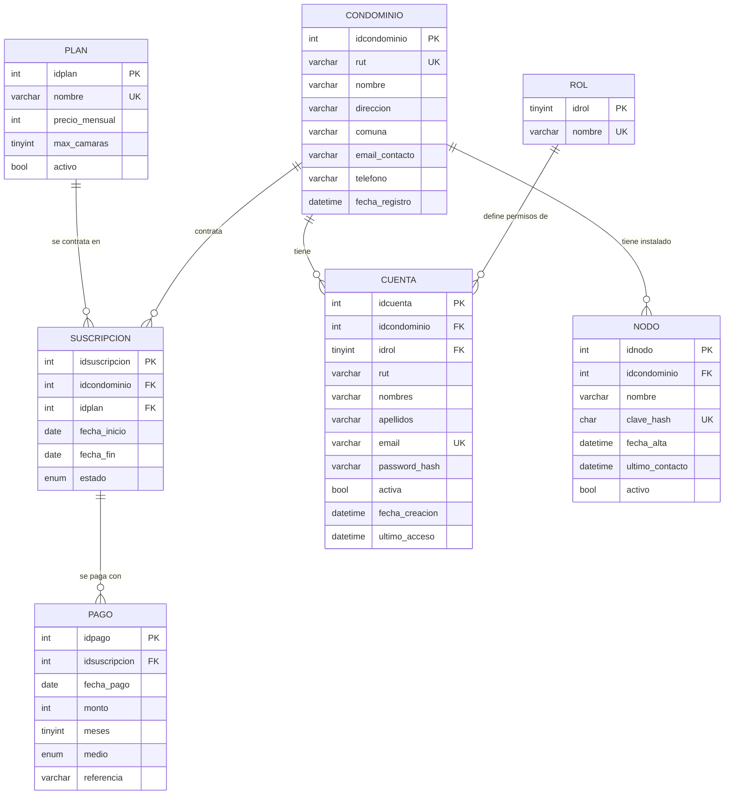
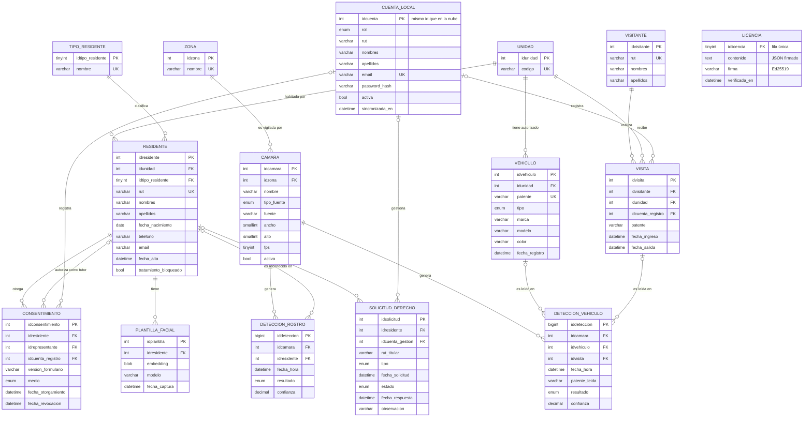

# Modelo de datos (DER) — Umbral Guardian

Arquitectura híbrida borde–nube con **dos bases de datos**, ambas en 3FN:

| Base | Dónde vive | Qué contiene | Script |
|---|---|---|---|
| `umbral_central` | Nube (RDS), solo la API accede | Clientes, planes, suscripciones, pagos, cuentas, nodos | `sql/central.sql` |
| `umbral_local` | PC de la portería de cada condominio | Residentes, consentimientos, plantillas faciales, vehículos, visitas, cámaras, detecciones, solicitudes | `sql/local.sql` |

Los datos personales y biométricos **nunca salen del condominio** (art. 14 quáter).
Para exportar como imagen: pegar cada bloque en https://mermaid.live o usar MySQL
Workbench → Database → Reverse Engineer sobre cada base.

## 1. Base central (plano de control)

## 2. Base local de cada condominio (plano de datos)

## Cómo se relacionan las dos bases

Las claves foráneas no pueden cruzar de una base a otra; el vínculo es lógico:

- Cada nodo se identifica ante la API con su **clave de nodo** (en la nube solo se guarda su hash en `NODO`). Así la API sabe a qué condominio pertenece el equipo.
- `CUENTA_LOCAL` es una **réplica** de las cuentas de `CUENTA` de ese condominio, con el mismo `idcuenta`. Se actualiza en cada sincronización y permite iniciar sesión sin internet.
- `LICENCIA` guarda el último estado de la suscripción **firmado** por la API (Ed25519). El nodo la verifica con la clave pública y no puede modificarla.
- Por ser una base de un solo condominio, las tablas locales no llevan `idcondominio`.

## Decisiones de normalización

| Decisión | Motivo |
|---|---|
| Separar base central y base local | Los datos biométricos y el historial no salen del condominio (art. 14 quáter; se evita la transferencia internacional de datos sensibles, arts. 27–28). La nube solo administra identidades y suscripciones. |
| `CUENTA` (quien opera el sistema) separada de `RESIDENTE` (titular reconocido) | Son entidades distintas: el residente no inicia sesión y la cuenta no es titular biométrico. |
| `UNIDAD` como entidad propia | Evita repetir el texto del departamento en residentes, vehículos y visitas (3FN). |
| `VEHICULO` depende de `UNIDAD` y no del residente | Los residentes rotan; la unidad permanece. |
| `VISITANTE` separado de `VISITA` | El nombre depende del RUT, no de cada ingreso (3FN). |
| Una sola tabla `PLANTILLA_FACIAL`, sin foto | Se eliminó la duplicación de vectores y no se almacena la imagen (minimización, art. 3 c). |
| Patente guardada sin guiones | La versión "sin guion" era un dato derivado. |
| Tutor como FK a `RESIDENTE` | Evita guardar nombre y RUT del tutor dentro del consentimiento. |
| `resultado` en las detecciones | Registra el resultado al momento del evento y se conserva cuando el residente se suprime y el evento queda anonimizado. |
| `rut_titular` en `SOLICITUD_DERECHO` | Constancia de la solicitud (art. 11) que sobrevive a la supresión del titular. |
| `CUENTA_LOCAL` y `LICENCIA` | Réplicas controladas de la nube para operar sin conexión; no son fuente de verdad. |
